# LeaveFlow - Employee Leave Management System

A web-based employee leave management application built with React, FastAPI, PostgreSQL, and AWS.

## Live Website
- Frontend: https://krishnakumarcloud.online
- API: https://api.krishnakumarcloud.online
- API Docs: https://api.krishnakumarcloud.online/docs

## Features
- Employee login and role-based access
- Leave application and approval workflow
- Leave balance and leave history
- Employee document listing and PDF download
- Protected leave and document APIs

## Technology Stack
- Frontend: React, Vite
- Backend: Python, FastAPI
- Database: PostgreSQL on Amazon RDS
- Cloud: AWS EC2, S3, Application Load Balancer, Route 53

## Project Folders
- `backend/` - FastAPI application
- `frontend/` - React application
- `database/` - Database schema

## Security
Keep `.env`, passwords, JWT secrets, and AWS credentials out of GitHub.

## Project Screenshots

### Screenshot 01
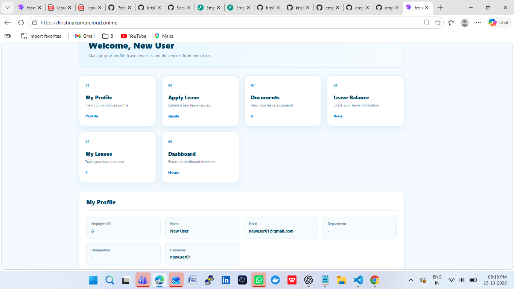

### Screenshot 02
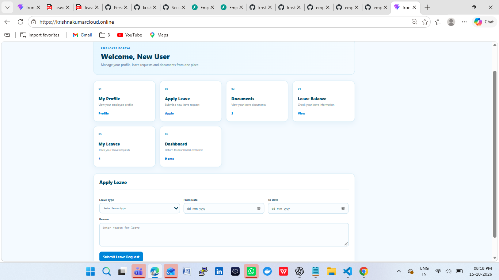

### Screenshot 03
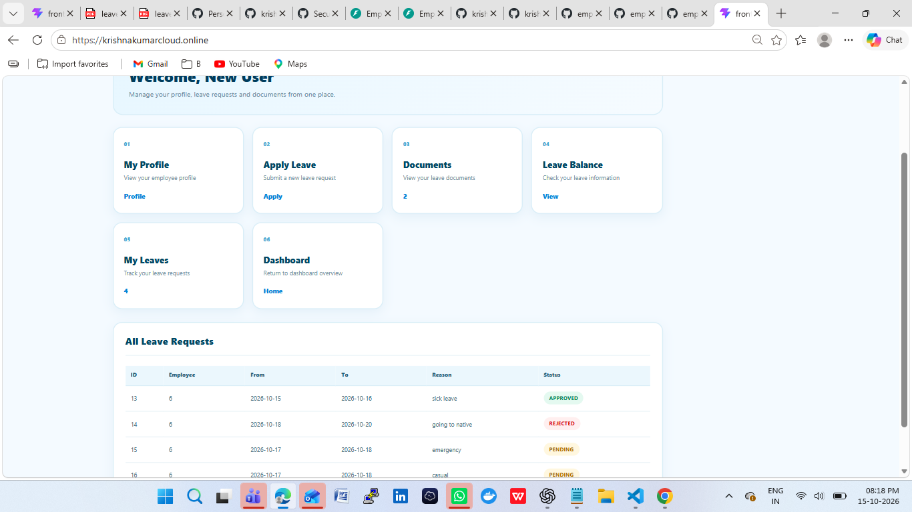

### Screenshot 04
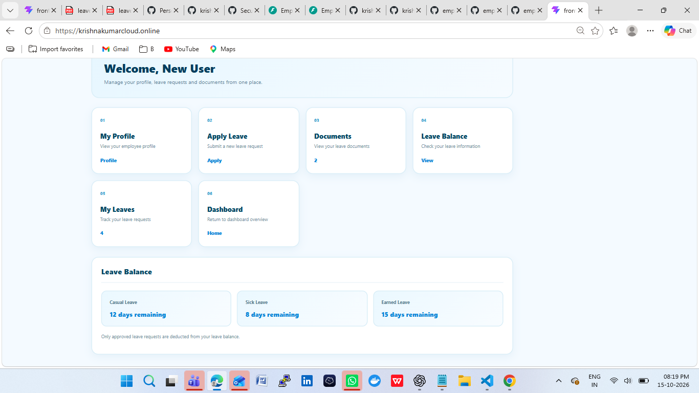

### Screenshot 05
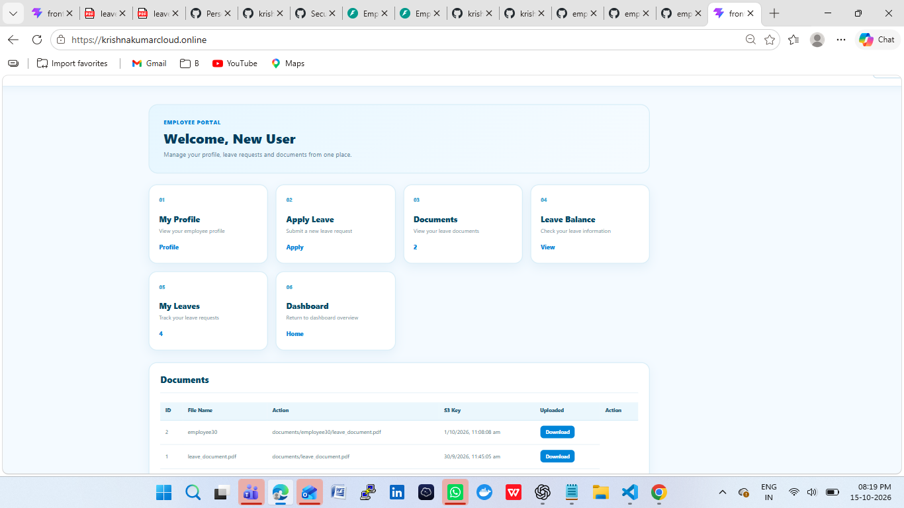

### Screenshot 06

### Screenshot 07
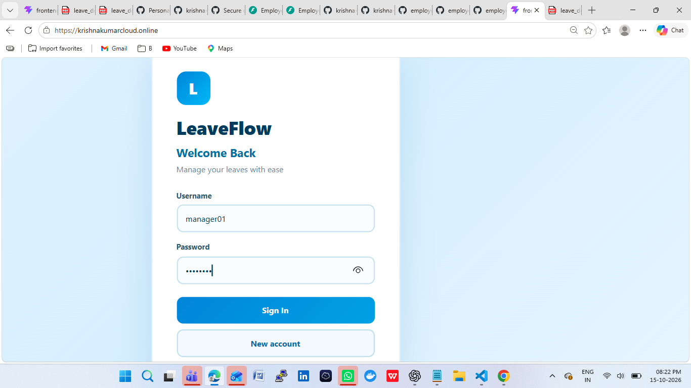

### Screenshot 08
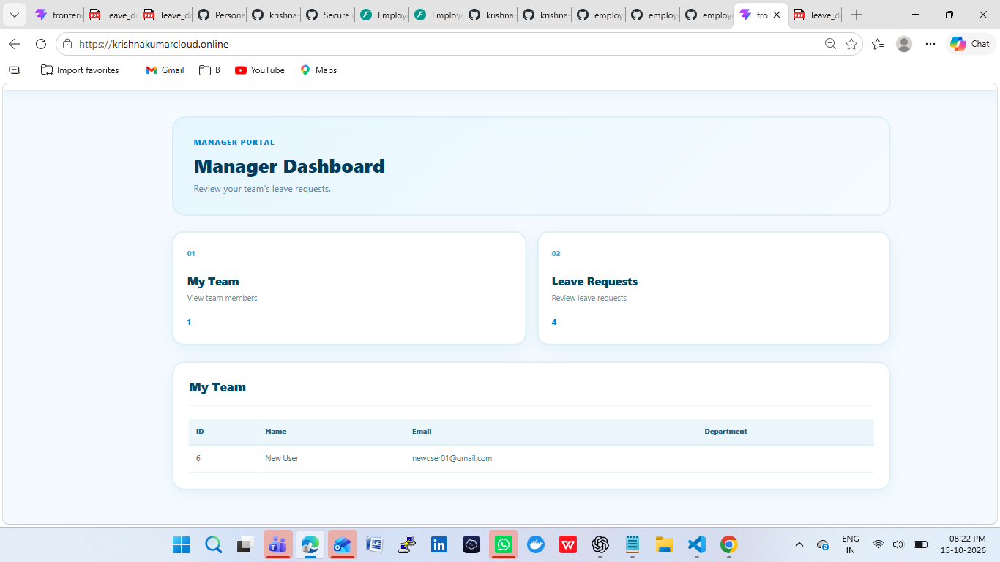

### Screenshot 09

### Screenshot 10
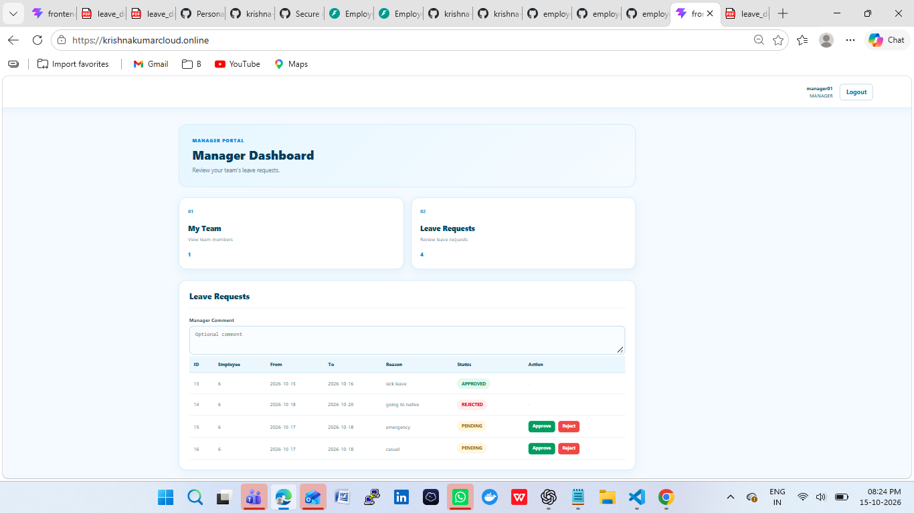

### Screenshot 11

### Screenshot 12

### Screenshot 13
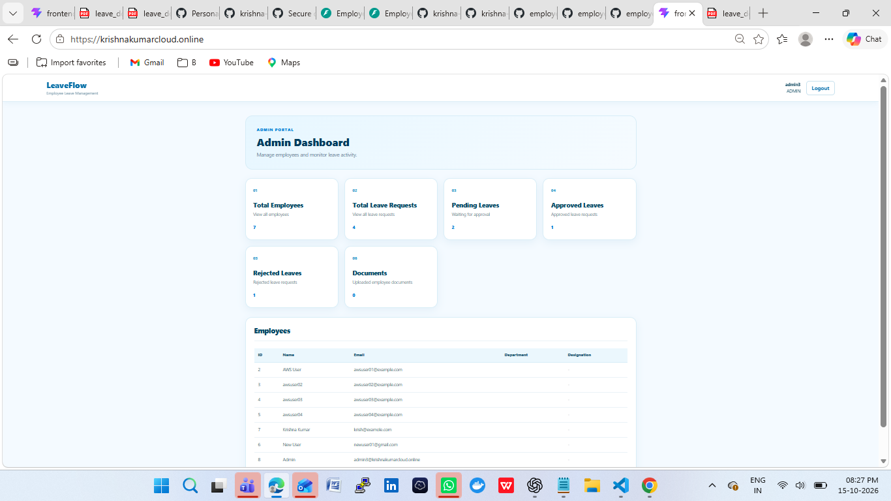

### Screenshot 14
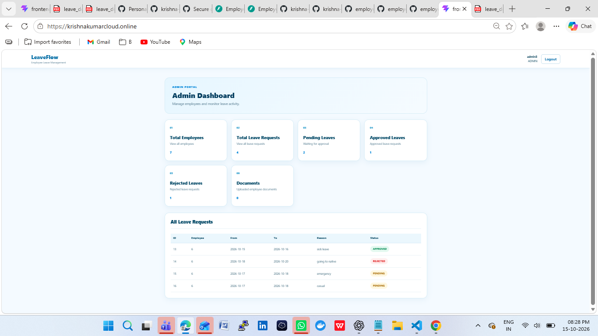

### Screenshot 15
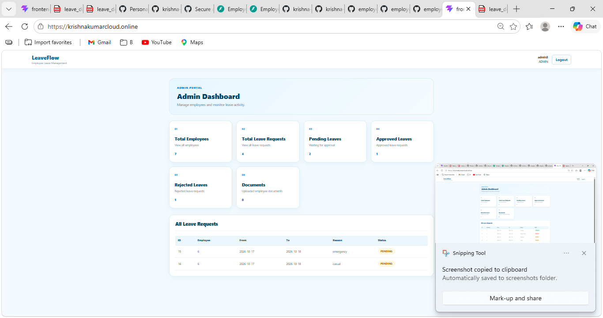

### Screenshot 16
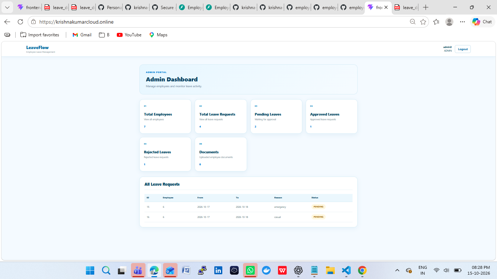

### Screenshot 18

### Screenshot 19

### Screenshot 20
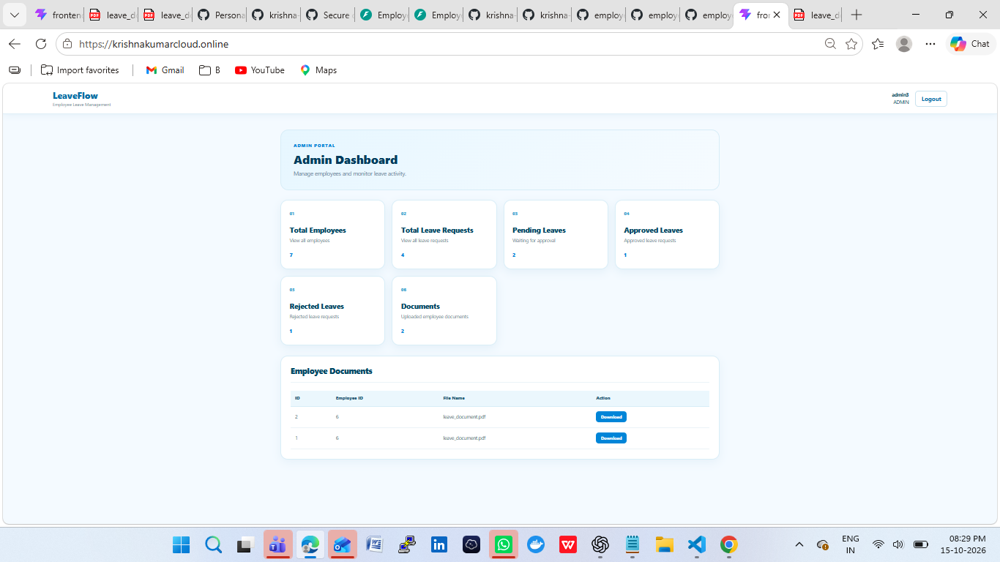

### Screenshot 21
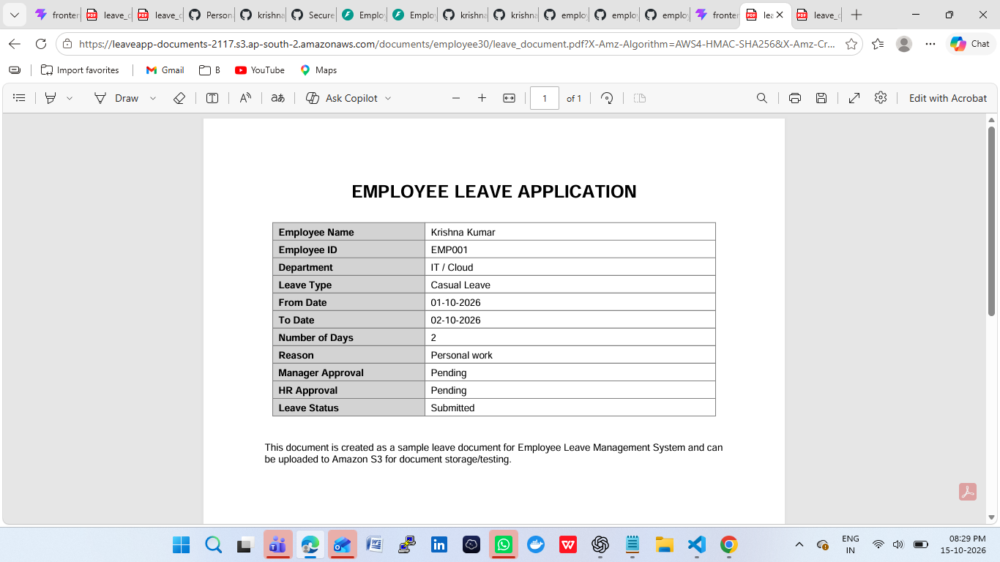

### Screenshot 22

### Screenshot 23
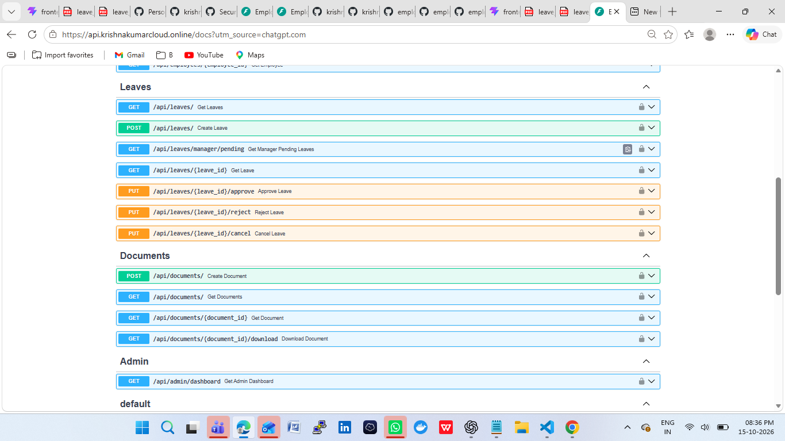

### Screenshot 24

### Screenshot 25

### Screenshot 26

### Screenshot 27
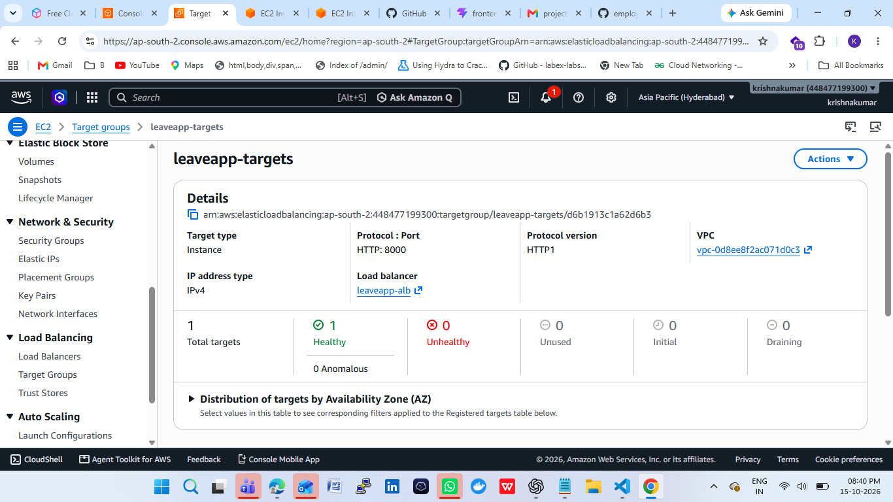

### Screenshot 28
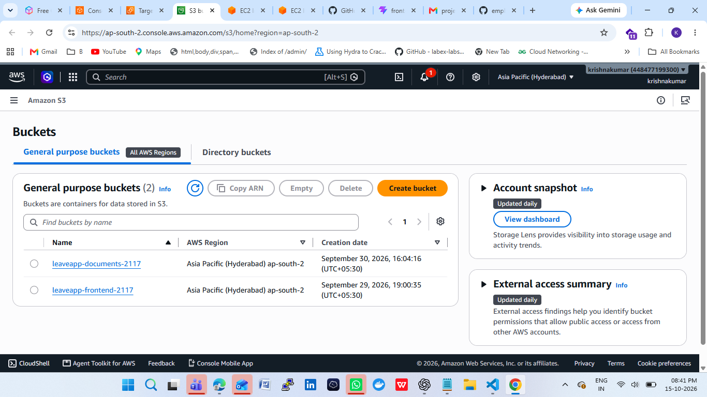

### Screenshot 29
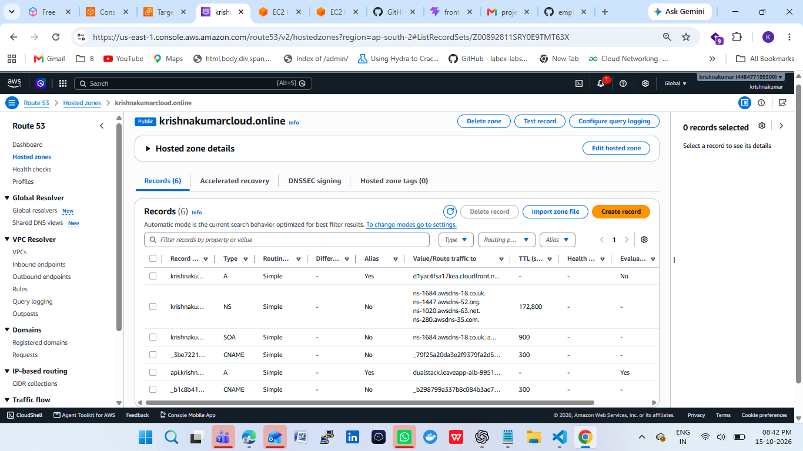

### Screenshot 30

### Screenshot 31

