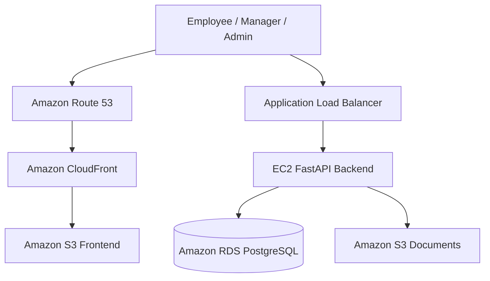
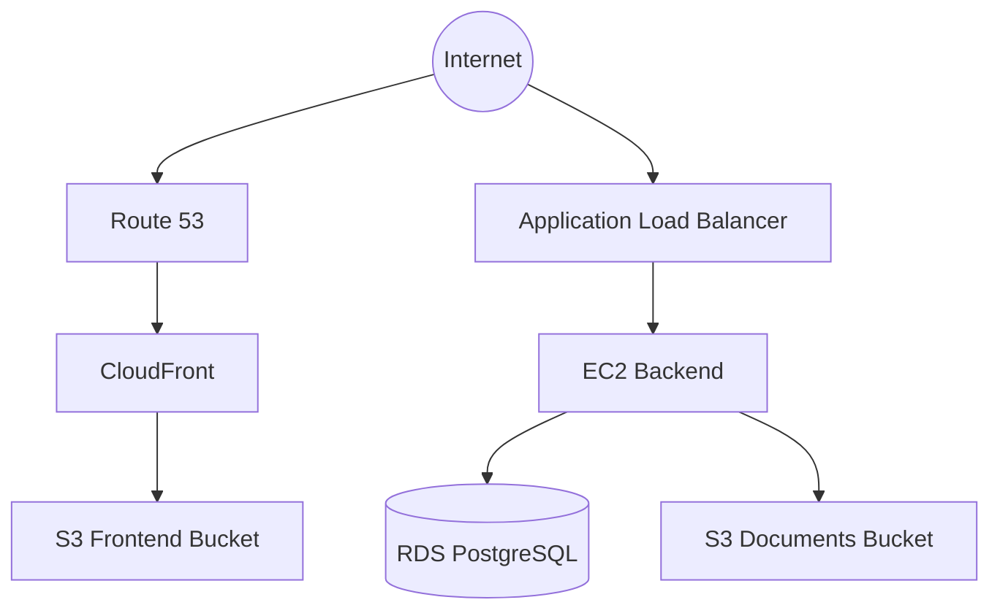


<div align="center">

# 🏗️ Employee Leave Management System

### System Architecture & Design


**A cloud-based employee leave management application**

</div>

---

## 📌 Overview

The Employee Leave Management System is a web application designed to manage employee leave requests, employee information, and document references.

The application uses a React frontend, a FastAPI backend, and PostgreSQL. AWS services support hosting, database management, load balancing, frontend delivery, and document storage where configured.

---

## 🏛️ High-Level Architecture



> **Note:** This is a logical architecture diagram. Confirm the actual DNS records, CloudFront origin settings, and ALB routing configuration before treating every arrow as an active production traffic path.

---

## ⚙️ Architecture Components

| Component                     | Responsibility                                                                   |
| ----------------------------- | -------------------------------------------------------------------------------- |
| **React**                     | Provides the web interface for employees, managers, and administrators.          |
| **FastAPI**                   | Handles application APIs, authentication, leave requests, and document metadata. |
| **Amazon EC2**                | Hosts the backend application when deployed there.                               |
| **Application Load Balancer** | Routes incoming backend requests to registered targets.                          |
| **Amazon RDS for PostgreSQL** | Stores relational application data when configured as the production database.   |
| **Amazon S3 — Frontend**      | Stores frontend static assets when used for frontend hosting.                    |
| **Amazon S3 — Documents**     | Stores employee document files when integrated with the backend.                 |
| **Amazon Route 53**           | Provides DNS routing for a configured domain.                                    |
| **Amazon CloudFront**         | Provides content delivery when configured for the frontend or other origins.     |

---

## 🔄 Application Request Flow

### 1. User Access

Users open the application through its configured website address.

### 2. Frontend

The React frontend displays the login page and the appropriate application dashboard.

### 3. API Request

The frontend sends HTTP requests to the FastAPI backend.

### 4. Load Balancing

The Application Load Balancer routes requests to healthy registered backend targets.

### 5. Backend Processing

FastAPI validates the request and applies the application's authentication and authorization rules.

### 6. Database Operations

The backend reads or updates application data in PostgreSQL.

### 7. Document Operations

For supported document operations, the backend uses document metadata and the configured Amazon S3 integration.

### 8. Response

The backend returns an API response to the frontend, which updates the interface.

---

## 🔐 Security Design

Recommended security controls include:

* Use HTTPS for public application traffic.
* Validate authentication and authorization on protected API endpoints.
* Restrict database access using AWS Security Groups.
* Keep database credentials and JWT secrets outside source code.
* Apply least-privilege IAM permissions to AWS resources.
* Protect employee documents from unauthorized access.
* Keep production configuration separate from local development settings.
* Monitor application and infrastructure logs.

*These are design recommendations; verify each control in the deployed environment.*

---

## ☁️ AWS Deployment View



The diagram illustrates a possible deployment arrangement. The actual request paths depend on the configured AWS resources and application endpoints.

---

## 🧰 Technology Stack

| Layer                    | Technology                                                   |
| ------------------------ | ------------------------------------------------------------ |
| Frontend                 | React, JavaScript, Vite                                      |
| Backend                  | Python, FastAPI                                              |
| ORM                      | SQLAlchemy                                                   |
| Database                 | PostgreSQL                                                   |
| Authentication           | JWT-based authentication, as implemented in the backend      |
| Cloud Infrastructure     | Amazon EC2, Application Load Balancer, Amazon RDS, Amazon S3 |
| DNS and Content Delivery | Route 53 and CloudFront, when configured                     |

---

## 📁 Related Project Directories

```text
employee-leave-management/
├── architecture/
│   └── README.md
├── backend/
│   └── app/
├── database/
│   ├── README.md
│   └── schema.sql
├── frontend/
├── screenshots/
└── README.md
```

---

## 🚀 Design Goals

* **Maintainability:** Separate frontend, backend, and database responsibilities.
* **Scalability:** Use load balancing and managed services where appropriate.
* **Security:** Protect authentication data, employee records, and documents.
* **Reliability:** Monitor application health and configure suitable backups.
* **Clarity:** Document the major components and their interactions.

---

<div align="center">

### Built to demonstrate practical application development and AWS architecture concepts.

**Employee Leave Management System**

</div>
