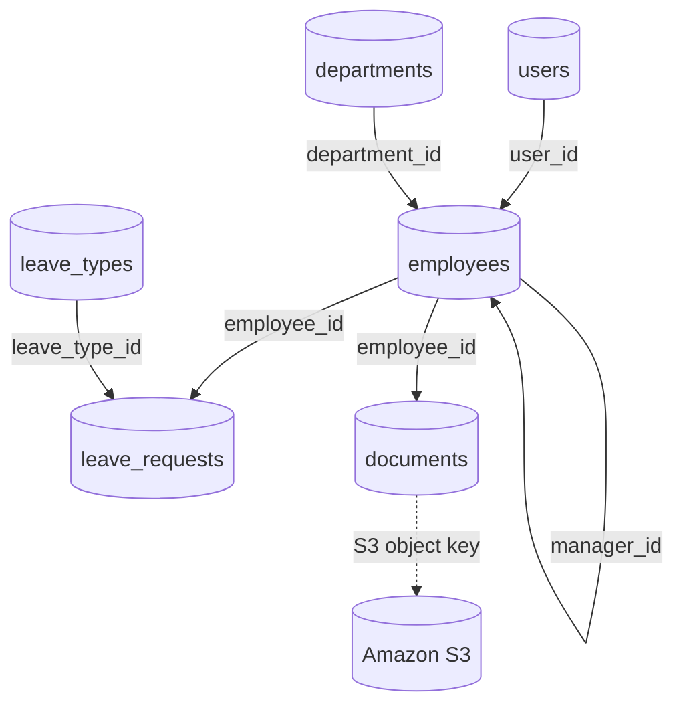
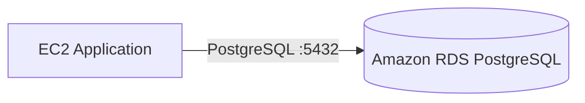
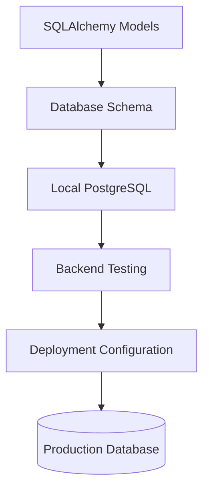


<div align="center">

# 🗄️ Employee Leave Management System

### Database Documentation

**Reliable Data • Structured Relationships • Secure Storage**


</div>

---

## 📌 Overview

The **Employee Leave Management System** uses PostgreSQL as its relational database and SQLAlchemy as its ORM.

The database supports:

* 👤 User accounts and roles
* 🏢 Departments and employee profiles
* 🌴 Leave categories and leave applications
* 📄 Employee document metadata
* ☁️ Amazon S3 document storage references

> **Database design:** The current backend models define six core tables connected through primary keys and foreign keys.

---

## 🏗️ Database Architecture



*The diagram represents the relationships declared in the current SQLAlchemy models. Actual document storage depends on the application’s S3 configuration.*

---

## ⚙️ Technology Stack

| Component                  | Technology                               |
| :------------------------- | :--------------------------------------- |
| 🗄️ Database               | PostgreSQL                               |
| 🔗 ORM                     | SQLAlchemy                               |
| ⚡ Backend                  | FastAPI                                  |
| 💻 Local Development       | PostgreSQL                               |
| ☁️ Cloud Database          | Amazon RDS for PostgreSQL, if configured |
| 🔌 Default PostgreSQL Port | `5432`                                   |
| 🏷️ Database Name          | `employee_leave`                         |

---

## 📊 Database Tables

| Table            | Responsibility                                                                      |
| :--------------- | :---------------------------------------------------------------------------------- |
| `users`          | Authentication details, usernames, email addresses, password hashes, and roles      |
| `departments`    | Department names and organizational grouping                                        |
| `employees`      | Employee details, department assignments, manager references, and employment status |
| `leave_types`    | Leave categories and default leave-day values                                       |
| `leave_requests` | Leave dates, reasons, request status, and manager comments                          |
| `documents`      | Document filenames, S3 object keys, employee associations, and upload timestamps    |

### 🔑 Key Relationships

* **Users → Employees:** `employees.user_id` references `users.id`.
* **Departments → Employees:** `employees.department_id` references `departments.id`.
* **Employees → Employees:** `employees.manager_id` supports manager relationships.
* **Employees → Leave Requests:** `leave_requests.employee_id` references `employees.id`.
* **Leave Types → Leave Requests:** `leave_requests.leave_type_id` references `leave_types.id`.
* **Employees → Documents:** `documents.employee_id` references `employees.id`.

---

## 🗂️ Project Files

```text
employee-leave-management/
│
├── backend/
│   └── app/
│       ├── models.py       # SQLAlchemy table definitions
│       └── database.py     # Database connection and Base
│
└── database/
    ├── README.md           # Database documentation
    └── schema.sql          # PostgreSQL table definitions
```

---

## 🚀 Local Database Setup

### 1. Create the Database

If the database does not already exist:

```sql
CREATE DATABASE employee_leave;
```

### 2. Apply the Schema

Run this command from the repository root:

```bash
psql -U postgres -d employee_leave -f database/schema.sql
```

Replace `postgres` with your PostgreSQL username if required.

### 3. Verify the Tables

Connect to the database:

```bash
psql -U postgres -d employee_leave
```

Then list the tables:

```sql
\dt
```

The schema defines these six tables:

`users` · `departments` · `employees` · `leave_types` · `leave_requests` · `documents`

> ⚠️ **Important:** Applying `schema.sql` creates tables that do not already exist. It does not migrate existing tables or populate application data.

---

## ☁️ AWS RDS Architecture

For an AWS deployment using Amazon RDS for PostgreSQL, the application can connect to the database over a controlled network path.



### Recommended Configuration

* 🔒 Allow connections only from authorized application resources.
* 🛡️ Restrict port `5432` using Security Groups.
* 🔑 Keep database credentials outside source code.
* 🚫 Avoid public database access unless specifically required and secured.
* 💾 Review backup retention and recovery settings.

*Verify the live AWS configuration before describing these recommendations as deployed settings.*

---

## 🔐 Security Best Practices

| Practice                | Purpose                                                             |
| :---------------------- | :------------------------------------------------------------------ |
| Password hashing        | Avoid storing plaintext passwords                                   |
| Environment variables   | Keep credentials outside application source code                    |
| Network restrictions    | Limit database access to authorized resources                       |
| Least privilege         | Give database users only the permissions they need                  |
| Secure document storage | Keep actual document files in controlled storage such as Amazon S3  |
| Secret protection       | Prevent credentials and private keys from being committed to GitHub |

**Never commit** `.env` files, database passwords, JWT secrets, AWS credentials, private keys, or private employee documents.

---

## 💾 Backup & Recovery

For PostgreSQL, `pg_dump` can create a logical backup.

```bash
pg_dump -U postgres -d employee_leave -f employee_leave_backup.sql
```

For Amazon RDS deployments, review automated backup settings and recovery options. Store backups securely and test restoration procedures.

---

## 🧪 Development Workflow



Keep local and production database settings separate. Confirm that schema changes are tested before applying them to a production database.

---

## 📌 Current Database Scope

This documentation reflects the six tables defined in `backend/app/models.py`.

The current models **do not define separate `leave_balances` or `audit_logs` tables**. Those features should only be documented as implemented after the corresponding models and database tables are added.

### 📚 Related Files

* [`models.py`](../backend/app/models.py)
* [`database.py`](../backend/app/database.py)
* [`schema.sql`](./schema.sql)

---

<div align="center">

### 🗄️ Structured Data. Secure Access. Reliable Applications.

*Employee Leave Management System — Database Documentation*

</div>
