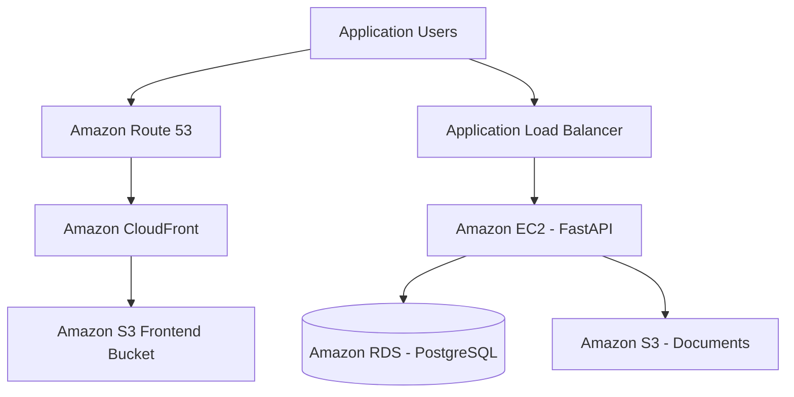


<div align="center">

# ☁️ AWS Deployment Guide

### Employee Leave Management System


**Deployment architecture, infrastructure components, and operational guidance**

</div>

---

## 📌 Overview

This document describes the AWS services used or considered for hosting the Employee Leave Management System.

The application consists of a React frontend, a FastAPI backend, and a PostgreSQL database. AWS services can provide frontend hosting, backend compute, load balancing, managed database services, object storage, DNS, and content delivery.

> **Important:** This document describes the deployment design. Verify the live AWS configuration before treating every service or security setting as currently active.

---

## 🏗️ AWS Architecture



The exact traffic path depends on the configured DNS records, CloudFront origins, ALB listeners, and backend endpoints.

---

## 🧰 AWS Services

| Service                       | Purpose                                                         |
| ----------------------------- | --------------------------------------------------------------- |
| **Amazon EC2**                | Runs the FastAPI backend application.                           |
| **Application Load Balancer** | Distributes backend requests to registered targets.             |
| **Amazon RDS for PostgreSQL** | Hosts relational application data.                              |
| **Amazon S3 — Frontend**      | Stores frontend build files when configured for static hosting. |
| **Amazon S3 — Documents**     | Stores employee documents when integrated with the backend.     |
| **Amazon Route 53**           | Routes DNS queries for a configured domain.                     |
| **Amazon CloudFront**         | Delivers frontend content through a CDN when configured.        |

---

## 🚀 Deployment Workflow

### 1. Prepare the Application

* Review frontend and backend configuration.
* Install the required runtime dependencies.
* Configure environment variables.
* Test the application locally before deployment.

### 2. Configure the Database

* Create or identify the PostgreSQL database.
* Configure the backend database connection.
* Restrict database access to authorized resources.
* Confirm that the schema matches the application's SQLAlchemy models.

### 3. Deploy the Backend

* Deploy the backend application to EC2.
* Install the required Python dependencies.
* Configure the application service and environment variables.
* Confirm that the backend starts successfully.
* Test the health endpoint, such as `/health`, if enabled.

### 4. Configure the Load Balancer

* Configure the target group for the backend.
* Register the EC2 instance.
* Configure the health check path.
* Verify that the target reports healthy.
* Configure listeners and HTTPS as required.

### 5. Deploy the Frontend

* Build the React application.
* Upload the generated static assets to the configured S3 bucket.
* Configure the frontend API endpoint.
* Verify that the frontend can communicate with the backend.

### 6. Configure DNS and Content Delivery

* Configure Route 53 records for the domain.
* Configure CloudFront origins and distribution settings if used.
* Verify DNS resolution and HTTPS access.
* Confirm that frontend and backend routes work as expected.

### 7. Validate the Application

* Test login and authentication.
* Test employee and leave-management workflows.
* Test document operations.
* Verify backend health and database connectivity.
* Review application and infrastructure logs.

---

## 🔐 Security Checklist

* [ ] Use HTTPS for public application traffic.
* [ ] Restrict SSH access to trusted IP addresses.
* [ ] Restrict database port `5432` to authorized application resources.
* [ ] Avoid exposing the RDS database publicly unless specifically required.
* [ ] Store credentials in protected environment configuration.
* [ ] Use least-privilege IAM permissions.
* [ ] Protect S3 objects from unauthorized public access.
* [ ] Avoid committing `.env` files, private keys, or AWS credentials.
* [ ] Configure database backups and review recovery procedures.
* [ ] Monitor application health and infrastructure logs.

---

## 🧪 Deployment Validation

| Component        | Validation                                                                    |
| ---------------- | ----------------------------------------------------------------------------- |
| EC2              | Confirm instance state and backend service status.                            |
| Backend API      | Test the configured health endpoint and API routes.                           |
| Load Balancer    | Confirm target health and listener configuration.                             |
| PostgreSQL / RDS | Verify database connectivity and schema compatibility.                        |
| S3 Frontend      | Confirm the frontend assets are available through the intended delivery path. |
| S3 Documents     | Test authorized document upload or download workflows.                        |
| Route 53         | Verify domain resolution.                                                     |
| CloudFront       | Verify distribution status, origin configuration, and HTTPS access.           |

---

## ⚙️ Configuration and Secrets

Keep environment-specific settings outside source code.

Example placeholders:

```text id="w81f7e"
DATABASE_URL=<DATABASE-CONNECTION-STRING>
JWT_SECRET=<JWT-SECRET>
AWS_REGION=<AWS-REGION>
S3_DOCUMENTS_BUCKET=<DOCUMENTS-BUCKET>
```

These are illustrative configuration names. Use the actual variable names expected by the application code.

**Never put real passwords, JWT secrets, AWS access keys, or production credentials in this documentation.**

---

## 💾 Backup and Recovery

For a production deployment:

* Review the configured RDS backup retention period.
* Verify that recovery procedures are documented.
* Test restoration in a suitable environment.
* Protect backups from unauthorized access.
* Keep copies of important deployment configuration without secrets.

---

## 📁 Related Project Directories

```text id="8d48cl"
employee-leave-management/
├── architecture/
│   └── README.md
├── backend/
├── database/
│   ├── README.md
│   └── schema.sql
├── deployment/
│   └── README.md
├── frontend/
├── screenshots/
└── README.md
```

---

## 🎯 Deployment Goals

* **Availability:** Monitor application health and service status.
* **Security:** Restrict access to application resources and sensitive data.
* **Maintainability:** Keep deployment configuration documented.
* **Scalability:** Use suitable AWS services as application requirements grow.
* **Reliability:** Validate database backups and recovery procedures.

---

<div align="center">

### ☁️ Secure Deployment • Reliable Infrastructure • Cloud Architecture

*Employee Leave Management System*

</div>
