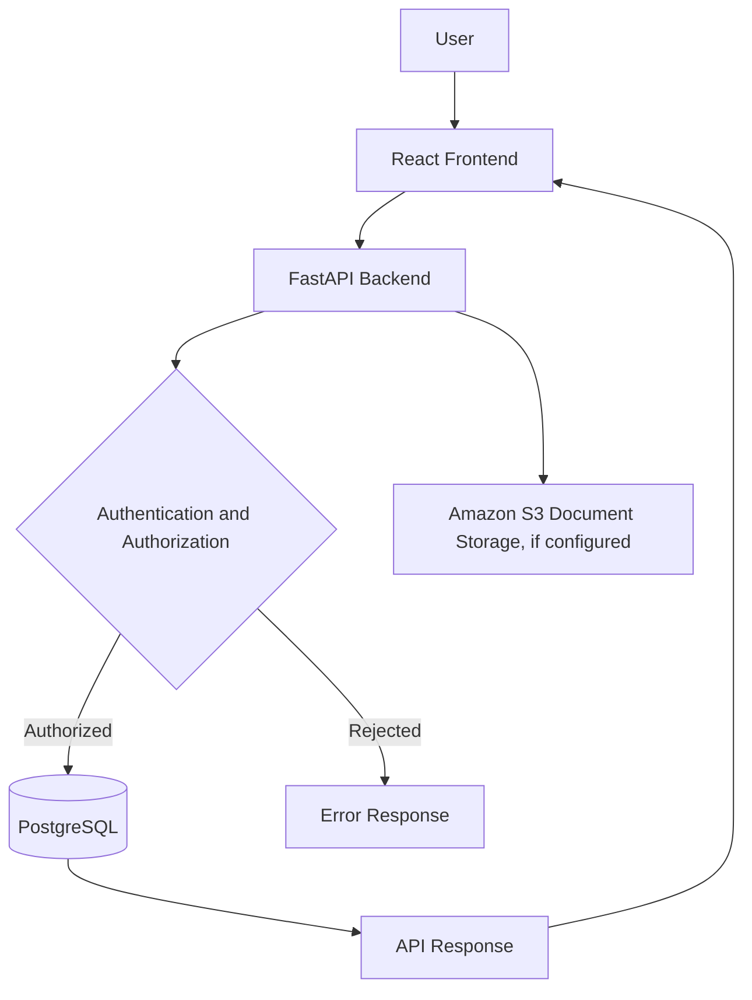



# 📚 Project Documentation

### Employee Leave Management System

**Explore the system design, APIs, database, deployment, and security.**

---

## 🗂️ Documentation Index

| Document                                  | Description                                                |
| ----------------------------------------- | ---------------------------------------------------------- |
| [🔌 API Reference](api-reference.md)      | Backend endpoints, authentication, and request testing     |
| [🏗️ Architecture](architecture.md)       | Application components and request flow                    |
| [🗄️ Database](database.md)               | Database tables, relationships, and PostgreSQL setup       |
| [☁️ Deployment](deployment.md)            | AWS infrastructure and deployment validation               |
| [🔐 Security](security.md)                | Authentication, authorization, secrets, and cloud security |
| [🧪 Testing](testing.md)                  | Functional testing and validation checklist                |
| [🛠️ Troubleshooting](troubleshooting.md) | Common errors and debugging guidance                       |

---

## 🚀 About the Project

The Employee Leave Management System is a web application designed to manage employee profiles, leave applications, leave requests, and employee document references.

### Technology Stack

* **Frontend:** React and Vite
* **Backend:** Python and FastAPI
* **ORM:** SQLAlchemy
* **Database:** PostgreSQL
* **Cloud:** AWS services used or configured for deployment

---

## 🔄 Application Workflow

*This is a high-level conceptual view. Refer to the individual documents and actual project configuration for implementation details.*

---

**📖 One project. Organized documentation. Easier maintenance.**

